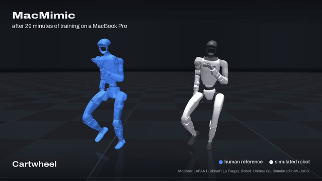
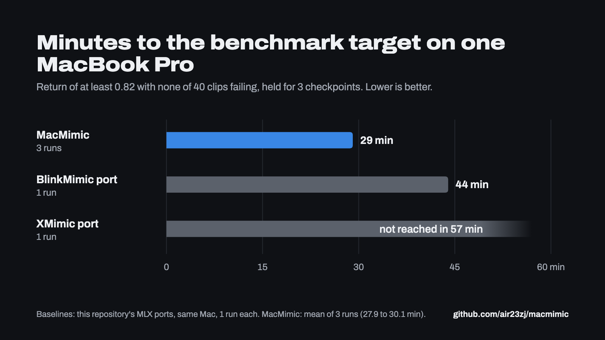

# MacMimic

<p align="center"></p>

**A simulated Unitree G1 learns to track 40 human motions in 29 minutes on a MacBook Pro.** MacMimic trains whole-body
motion tracking end to end on Apple silicon: MuJoCo simulates 4,096 robots on the CPU while MLX trains a differentiable
world model and the policy on the GPU. No CUDA, no PyTorch, no cloud.

[Project page](https://air23zj.github.io/macmimic/) · [Results](RESULTS.md) ·
[What worked and what didn't](docs/macmimic_hillclimb.md)

## Results

<p align="center"></p>

MacBook Pro, M4 Pro, 48 GB. Target: average evaluation return of at least 0.82 with none of the 40 clips failing,
held for three checkpoints in a row.

| Preset | Runs | Time to target | Iteration |
|---|---|---|---|
| `macmimic` | 3 seeds | 27.9 / 29.2 / 30.1 min, mean 29.05 | 1600 / 1700 / 1700 |
| `blinkmimic` (this repository's port) | 1 | 44.0 min | 1600 |
| `xmimic` (this repository's port) | 1 | not reached in 57 min | |

- The baselines are this repository's MLX ports, timed on the same Mac; this is not a comparison with the original CUDA
  code on an NVIDIA GPU.
- At equal tracking quality (BlinkMimic's return 0.847 and 3.9 cm body position error at its target) MacMimic needs
  about 34-35 min, 1.25x faster. Tracking metrics for every checkpoint shown are in [RESULTS.md](RESULTS.md).
- Everything is simulation; the policy has not been run on a physical robot.

## Quickstart

```bash
git clone https://github.com/air23zj/macmimic && cd macmimic
uv sync
bash tools/download_data.sh                                  # 40 LAFAN1 clips retargeted to the G1 -> data/
uv run python tools/urdf_to_mjcf.py
bash scripts/train.sh macmimic logs/macmimic_s0 --seed 0     # 2000 iterations, ~35 min on an M4 Pro
uv run python -m supermimic_mlx.evaluate --run_dir logs/macmimic_s0 --min_it 1000
uv run python tools/time_to_target.py logs/macmimic_s0
```

## What is in this repository

MacMimic started as a port of [BlinkMimic](https://github.com/fuyichen0725/blinkmimic) (which contains a faithful
SuperMimic baseline) from mjlab / MuJoCo Warp / PyTorch + CUDA to Apple silicon. All four presets share the simulator,
MDP, reward and evaluator, as upstream:

| upstream (RTX 4090) | here (M-series Mac) |
|---|---|
| mjlab scene, MuJoCo Warp, 4096 worlds on the GPU | the same scene built with plain MuJoCo (`supermimic_mlx/scene.py`, checked field by field against mjlab's compile), 4096 worlds stepped by `mujoco.batch` on the CPU thread pool, per-world randomized model fields and solver warm starts |
| PyTorch networks, `torch.compile`, CUDA graphs, bf16 autocast | MLX networks, `mx.compile` over each whole update (world model; BPTT policy + critic), bf16 matmuls where the GPU runs them faster |
| `torch.optim.Adam` / `torch.optim.Muon` | `supermimic_mlx/optim.py`, same arithmetic (tested against PyTorch) |

- `--preset macmimic` — MacMimic: the `xmimic` preset retuned for time to target on a Mac. Policy batch 1024 instead of
  2048 (38 % less time per iteration for ~200 more iterations), step-size decay from iteration 1100, policy average
  0.99, evaluation probes from iteration 400 every 60 iterations on a worker thread, 2000 iterations. What was tried on
  the way, including what did not work, is in [docs/macmimic_hillclimb.md](docs/macmimic_hillclimb.md).
- `--preset supermimic` — SuperMimic (Liao et al., arXiv:2610.28480): upstream `train.py` without flags (paper hyperparameters).
- `--preset blinkmimic` — BlinkMimic: upstream `PRESET[main]` (structured semi-implicit world model, mirror
  augmentation, Muon on policy and world model, policy EMA, reference-action skip, contact reward, failure- and
  evaluation-guided resets, policy batch 2048 with a decaying 4× policy LR, 3500 iterations).
- `--preset xmimic` — [XMimic](https://github.com/nico-bohlinger/xmimic): BlinkMimic's algorithm and hyperparameters with
  XMimic's actor | learner split mapped onto one Mac: the learner (world model, policy, critic) runs from a worker thread
  on its own GPU stream while the main thread steps the CPU simulator and the probe sweeps with the policy of the
  previous iteration (XMimic's one-iteration staleness).

## Automatic configuration per Mac

`supermimic_mlx/hw.py` detects the chip (M1 … M6, base / Pro / Max / Ultra), its cores and GPU memory at startup and
sets what only affects speed and memory: simulator threads (all cores), MLP matmul precision (`--precision auto`:
bf16, upstream's autocast, wherever a short micro-benchmark shows this GPU runs it at least as fast as fp32 — M1/M2
emulate bf16 and get fp32), BPTT checkpointing when the estimated learner peak plus the 3.6 GB replay buffer would not
fit the GPU's working set, and MLX's wired-memory limit. The choices are printed (`[hw] ...`) and stored in `args.json`.
Every setting can be forced by its flag (`--sim_threads`, `--precision`, `--checkpoint_bptt`).

Measured on an M4 Pro (14 CPU cores, 48 GB), BlinkMimic's algorithm, 4096 worlds:

| | it/s | 3500 iterations | GPU peak |
|---|---|---|---|
| fp32 | 0.57 | 102 min | 9.2 GB |
| `blinkmimic` (auto: bf16) | 0.65 | 90 min | 6.4 GB |
| `xmimic` (auto: bf16 + actor \| learner) | 0.72 | 81 min | 6.5 GB |

The learner is GPU-compute bound (the BPTT forward runs at ~5.7 TFLOPS, ~70 % of the bf16 matmul peak overall), so the
remaining time is the algorithm's arithmetic; `--profile` prints a per-phase breakdown, `tools/bench_learner.py` times
the pieces of the policy update.

## Setup

macOS on Apple silicon, [uv](https://docs.astral.sh/uv/), `curl`, `ffmpeg` (videos only).

```bash
uv sync
bash tools/download_data.sh                            # 40 G1-retargeted LAFAN1 clips + G1 description -> data/
uv run python tools/urdf_to_mjcf.py                    # G1 MJCF (free-floating pelvis)
uv run python tools/test_env.py                        # state round-trip, FK vs MuJoCo, reference playback
uv run --group dev pytest -q                           # unit tests
# optional: the mjlab reference scene for tests/test_scene.py (mjlab installs on macOS; only used here)
uv run --with mjlab python tools/build_scene_mjlab.py
```

## Train, evaluate, render

```bash
bash scripts/train.sh blinkmimic logs/blinkmimic_s0 --seed 0     # 3500 iterations
bash scripts/train.sh xmimic logs/xmimic_s0 --seed 0
bash scripts/train.sh macmimic logs/macmimic_s0 --seed 0         # 2000 iterations, ~35 min on an M4 Pro
bash scripts/train.sh supermimic logs/supermimic_s0 --seed 0 --iterations 16000
bash scripts/benchmark.sh logs/bench                              # all three, then evaluation and time to target
uv run python -m supermimic_mlx.evaluate --run_dir logs/blinkmimic_s0          # every checkpoint -> eval.csv
uv run python tools/time_to_target.py logs/blinkmimic_s0                       # minutes to return >= 0.82
uv run python tools/render.py --ckpt logs/blinkmimic_s0/ckpt_003500 --clip fallAndGetUp1_subject1 --out fall.mp4
# as on the project page: simulated from the clip's first frame, reference beside the robot
uv run python tools/render.py --ckpt logs/macmimic_s0/ckpt_001700 --clip dance1_subject1 --from_clip_start \
    --start_s 104.5 --seconds 5 --look studio --ghost side --azimuth 90 --out cartwheel.mp4
```

`python -m supermimic_mlx.evaluate --watch` evaluates checkpoints while a run trains (it slows the run down).

## What differs from upstream, and why

- **Simulator backend.** CPU MuJoCo instead of MuJoCo Warp, with the same model, options (5 ms implicitfast,
  pyramidal cone, Newton 100/50 iterations, tolerance 1e-6) and per-world state, including the solver warm start
  (cleared at resets, as MuJoCo Warp's reset does). Collision meshes are reduced to their convex-hull vertices
  (MuJoCo collides with the hulls anyway; the trajectories agree to round-off, 1e-7 over 4 s) — this makes per-world
  models cheap. Results are not bitwise equal to MuJoCo Warp (different solver implementation), and CPU MuJoCo is
  deterministic, so evaluation needs no replicas.
- **Ground friction.** Upstream sets the friction of the world body's geoms to the bottom of the randomization range,
  but mjlab's plane is a child body ("terrain"), so that set is empty and the ground keeps friction 1.0. This port
  keeps that behavior (MuJoCo takes the max of a contact pair, so the effective friction is in [1.0, 1.2]).
- **Systems flags.** `--cuda_graph`, `--collect_graph`, `--reset_masked`, `--graph_early`, `--fused_*`,
  `--compile_more`, `--no_sync`, `--eprobe_graph`, `--ckpt_light` are CUDA wall-clock engineering; they have no MLX
  counterpart (mx.compile covers the fusion). Their random-stream changes do not apply; the masked reset is the eager
  reset. `--eprobe_async` keeps its semantics (the sweep advances this many steps per iteration with a snapshot of the
  EMA policy taken when it starts, and its failures apply when it ends), run inline.
- **Precision.** MLP matmuls in bf16 with fp32 master weights, LayerNorm, heads and losses in fp32 (upstream's
  autocast), or fp32 on GPUs without fast bf16. Muon's Newton-Schulz iteration runs in fp32 (torch: bf16).
- **Memory.** `--checkpoint_bptt` recomputes each imagined step in the backward pass; chosen automatically from the
  GPU memory (the SuperMimic policy batch of 4096 needs ~15 GB in bf16 without it).
- **XMimic.** Its JAX/XLA engineering (whole iterations as one XLA program, multi-GPU layouts, bf16 kernels) is
  CUDA-specific; what carries over to one Mac is the actor | learner overlap. Its "fast learner" hoisting is available as
  `--fast_learner` but is slower under MLX (one large batched goal encoding compiles worse than the per-step one), so the
  preset leaves it off. XMimic's 256 constraint rows per world do not apply (CPU MuJoCo allocates per world as needed).

## Layout

```
src/supermimic_mlx/
  robots/g1.py      G1 constants (actuators, joints, bodies, randomization) and the LAFAN1 loader
  scene.py          the MuJoCo scene (= mjlab's), solver options
  sim.py            batched tracking simulator on mujoco.batch: resets, reset sampler, sim context xi
  kinematics.py     differentiable FK (MLX)          motion.py   reference library, goal features
  mdp.py            reward, termination, observation, critic features
  networks.py       world model, policy, critic      optim.py    Adam / Muon (torch semantics)
  buffer.py         replay buffer                    mirror.py   left-right mirror augmentation
  train.py          training (all presets)           evaluate.py checkpoint evaluation
tools/              data download, MJCF, mjlab reference scene, env check, render, time to target,
                    tracking metrics, failure diagnostics (probe_failmap.py, move_diag.py)
docs/               project page (index.html, GitHub Pages) and the hill-climb record
```

## Attribution and licenses

Code: MIT. Ported from [BlinkMimic](https://github.com/fuyichen0725/blinkmimic) (Fuyi Chen, MIT), which builds on
[supermimic_vibed](https://github.com/zita-ch/supermimic_vibed) (Chong Zhang, MIT) and
[InstantTrack](https://github.com/Huy-Quang-Dao/instantTrack) (MIT); method: SuperMimic
([HybridRobotics/supermimic](https://github.com/HybridRobotics/supermimic), Apache-2.0; Liao et al. 2026), BeyondMimic
(reward, evaluation), SHAC / SuperTrack (learning through a differentiable model), Muon (Jordan et al. 2024; Liu et al.
2025). Simulation: [MuJoCo](https://mujoco.org) (Apache-2.0), [mjlab](https://github.com/mujocolab/mjlab) for the
reference scene. **Data:** LAFAN1 motions by Ubisoft La Forge, CC BY-NC-ND 4.0; G1 retargets and description by Unitree
(BSD-3-Clause), via the Hugging Face dataset `lvhaidong/LAFAN1_Retargeting_Dataset`. The data are not included;
trained checkpoints and videos derived from LAFAN1 (including the media in `docs/assets/`) are for
non-commercial research use only.
